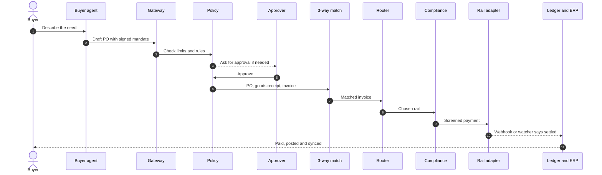
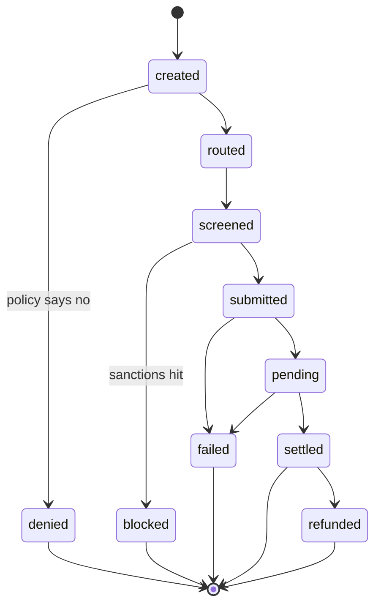
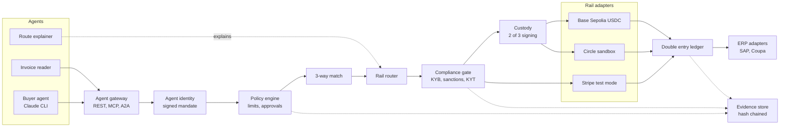

<div align="center">

# Agentic B2B Pay

**AI agents buy, people approve, and real sandbox rails move the money with full evidence.**


[](LICENSE)


[Screenshots](#screenshots) · [How a payment flows](#how-a-payment-flows) · [Quick start](#quick-start) · [Sandbox setup](#sandbox-setup) · [Architecture](#architecture) · [Safety](#safety)

</div>

> [!WARNING]
> **TEST MODE ONLY.** Every payment runs on Stripe test mode, the Circle developer sandbox or Base Sepolia testnet USDC. No real money moves. Live mode is refused unless live keys are set and a second operator approves.

---

## Screenshots

Captured at 1440 by 900 from the running app after a reset and the happy, sanctioned and poisoned scenarios.

| | |
|:--:|:--:|
| <br/>**Operator home** with money flow map | <br/>**Transaction history** |
| <br/>**Compliance** | <br/>**Treasury** |
| <br/>**Reconciliation** | <br/>**Branding** |
| <br/>**Developers** | <br/>**Client home** |
| <br/>**Approvals** | <br/>**Agents** |
| <br/>**Rules** | <br/>**Payment flow** of a settled payment |
| <br/>**Live transactions** | <br/>**Supplier onboarding** |
| <br/>**Light theme** | <br/>**Second bank** (Globex on Harbor Trust) |

---

## How a payment flows

The agent proposes. Policy, people, matching, routing and screening decide. The rail settles and the ledger posts only on a verified settlement.



### Payment status



| Status | Meaning |
|---|---|
| `created` | Payment intent exists for a matched invoice |
| `denied` | Policy or an approver said no |
| `routed` | The router picked a rail |
| `screened` | Compliance checks passed |
| `blocked` | A sanctions or KYT hit stopped it |
| `submitted` | Sent to the rail adapter |
| `pending` | The rail accepted it and it is in flight |
| `settled` | Verified webhook or watcher confirmed it |
| `failed` | The rail rejected it |
| `refunded` | A refund went out as a new forward payment |

Rendered copies: [sequence SVG](docs/diagrams/payment-sequence.svg) and [state SVG](docs/diagrams/payment-states.svg).

---

## Real transactions

These Stripe test mode PaymentIntents were read back from Stripe and matched to app rows. Full method and notes in [docs/verification/stripe-ids.md](docs/verification/stripe-ids.md).

| PaymentIntent | Amount | Status | App row | Verified |
|---|--:|:--:|:--:|:--:|
| `pi_3UXvUwHL3vGJPaYL0oiQpShy` | $1.00 | succeeded | none | Stripe only, contract test |
| `pi_3UXvUwHL3vGJPaYL0tnQgcWK` | $1.00 | succeeded | none | Stripe only, contract test |
| `pi_3UXvguHL3vGJPaYL0FUYcITL` | $8.50 | succeeded | `pi-1007` | Yes |
| `pi_3UXvhEHL3vGJPaYL0bb9bzsX` | $8,500.00 | succeeded | `pi-1014` | Yes |
| `pi_3UXvhsHL3vGJPaYL1sJxrXXX` | $8,500.00 | succeeded | `pi-1029` | Yes |
| `pi_3UXvinHL3vGJPaYL1mvnLR7h` | $8,500.00 | succeeded | `pi-1040` | Yes |

> [!NOTE]
> All rows have `livemode: false`. They are test mode objects and moved no real funds. App row ids come from the database at verification time and change after a reset.

---

## Capabilities

| # | Capability | What it does | Where |
|:-:|---|---|---|
| 1 | Agent identity | Ed25519 keys and a signed mandate per agent | `modules/kya.ts` |
| 2 | Policy engine | Per payment, total, supplier and category limits, kill switch, split detection | `modules/policy.ts` |
| 3 | Approval rules | Ordered rules, maker-checker, agents never approve their own spend | `modules/rules.ts` |
| 4 | 3-way match | PO, goods receipt and invoice with tolerance | `modules/match.ts` |
| 5 | Rail router | Scores card, ACH, Circle USDC and onchain USDC, skips rails without keys | `modules/router.ts` |
| 6 | Compliance gate | KYB, sanctions, OFAC wallet list, KYT, Travel Rule record | `modules/compliance.ts` |
| 7 | Custody | Local 2 of 3 threshold signing before a stablecoin send | `modules/custody.ts` |
| 8 | Ledger and reconciliation | Double entry journals, trial balance, camt.053 export | `modules/ledger.ts` |
| 9 | ERP sync | Local SAP and Coupa adapters, payee changes with four eyes and callback | `modules/erp.ts` |
| 10 | Evidence | Hash chained audit trail for every decision | `modules/evidence.ts` |

### Flow visuals

| View | What you see |
|---|---|
| Money flow map | Tenants, rails and suppliers as a flow, with blocked money split out |
| Payment flow | Each step from need to ERP with actor, time and duration, plus the rule decision next to Claude's explanation |
| Live transactions | Events stream in as they happen, with status chips |
| History | Search, filter by status, rail, tenant, date and amount, export CSV |

---

## Quick start

New here? Follow the step by step [guide to running transactions](docs/guide-transactions.md).

```bash
make setup        # npm install
cp .env.example .env
make dev          # bff on 8790, web on http://localhost:5180
```

Open http://localhost:5180, pick a demo user and run a scenario from the client home. Set `LLM_MODE=live` to use the local `claude` CLI for the buyer agent, invoice reader and route explainer.

<details>
<summary><b>Environment variables</b> (names only)</summary>

| Name | Purpose |
|---|---|
| `BFF_PORT` | BFF port, default 8790 |
| `LLM_MODE` | `mock` or `live` |
| `SESSION_SECRET` | Signs session cookies |
| `DB_FILE` | Optional database path |
| `STRIPE_SECRET_KEY` | Stripe test key |
| `STRIPE_WEBHOOK_SECRET` | Secret printed by `stripe listen` |
| `CIRCLE_API_KEY` | Circle sandbox API key |
| `CIRCLE_ENTITY_SECRET` | 32 byte hex entity secret |
| `BASE_SEPOLIA_RPC` | Base Sepolia RPC URL |
| `RAIL_POLL_MS` | Settlement watcher interval |
| `STRIPE_LIVE_SECRET_KEY` | Optional, live mode only |
| `CIRCLE_LIVE_API_KEY` | Optional, live mode only |
| `CIRCLE_LIVE_ENTITY_SECRET` | Optional, live mode only |
| `ONCHAIN_LIVE_PRIVATE_KEY` | Optional, live mode only |

</details>

---

## SSO setup

Sign in uses OpenID Connect with the authorization code flow, PKCE, state and nonce (openid-client 6). The login page shows "Sign in with SSO" first. The demo user list only shows when `DEMO_LOGIN=1`.

1. Generate the local Keycloak realm. This writes random passwords and a client secret into gitignored files and adds the `OIDC_*` lines to `.env`.
   ```bash
   node infra/keycloak/gen-realm.mjs
   ```
2. Start Keycloak 26.4.2 on port 8180 with Podman.
   ```bash
   podman compose -f infra/keycloak/compose.yml up -d
   curl -s http://localhost:8180/realms/b2bpay/.well-known/openid-configuration | head -c 120
   ```
3. Start the app with `npm run dev`. On first start the bff stores the provider from `OIDC_ISSUER`, `OIDC_CLIENT_ID` and `OIDC_CLIENT_SECRET` in the database, with the secret encrypted.
4. Sign in with any user from `infra/keycloak/test-users.local.md`. Realm `b2bpay`, client `b2bpay-web`, redirect `http://localhost:5180/api/auth/oidc/callback`.
5. Check the whole flow without a browser: `npm run oidc:check -w bff` (set `EMAIL=` to try another user).

Keycloak sends two extra claims in the ID token. `tenant` is `operator` or a business client id such as `tnt-acme`. `groups` holds group names. The provider's group to role map turns groups into a role. Users are created or updated on each sign in (just in time provisioning) and matched by subject, then by email.

Providers live in the operator Identity page, one per scope (`platform` or a bank id). A bank provider can only sign in clients of that bank. Every change goes through maker checker, so a second operator admin must approve it. SAML is not built yet and the Identity page says so.

Sessions are server side rows behind a signed httpOnly cookie with sameSite lax. They end after `SESSION_IDLE_MINUTES` (default 30) without activity and always after `SESSION_ABSOLUTE_HOURS` (default 12). The Sessions page lists open sessions and lets you revoke them. Sign in, sign out, failed sign in, expiry and revoke events land in the evidence chain. Sign out also ends the Keycloak session through its end session URL.

## Roles and permissions

Every route needs one permission, checked by `requirePermission`. Built-in roles are permission sets.

| Role | Main permissions |
|---|---|
| Operator admin | Everything except supplier review and payee change, including identity.manage, treasury.sweep, compliance.case.file, settings.live_toggle, platform.reset |
| Client admin | payments.pay, payments.approve, agents.manage, rules.edit, suppliers.review, developers.keys, roles.manage, sessions.manage, audit.read |
| Approver | payments.approve, payments.pay, payments.refund, flow.operate |
| AP clerk | payments.pay, flow.operate, suppliers.invite, suppliers.payee_change |
| Auditor | audit.read, compliance.read, treasury.read, users.read, rails.balances |

Custom roles are made on the Roles page. Client admins make roles for their company from client permissions only. Operator admins make roles for operator staff and can limit them to some business clients (entity scope). A role can carry an approval amount limit, so `payments.approve` is denied above it. Each custom role is based on a built-in role, which sets its approval level in the rules.

Separation of duties. The maker of a change cannot approve it. A person who approved an order cannot release its payment. The Permission check panel on the Roles page shows each step of a decision, so you can see why an action is allowed or denied.

## SCIM

The bff serves SCIM 2.0 at `/api/scim/v2` for one business client per token.

* `Users`: list (with `filter=userName eq "x"`), get, create, PATCH `active`, delete.
* `Groups`: list, get, create, PATCH members, delete. Built-in groups are client_admin, approver and ap_clerk. New groups become custom roles.

Make a token on the Developers page while a business client is active. It shows once and only its hash is stored. Turning a user off ends their sessions at once.

```bash
curl -s http://localhost:5180/api/scim/v2/Users -H "Authorization: Bearer $SCIM_TOKEN"
```

## Sandbox setup

### Stripe CLI

Forward test webhooks to the BFF and put the printed `whsec_` value in `.env` as `STRIPE_WEBHOOK_SECRET`.

```bash
STRIPE_API_KEY="$STRIPE_SECRET_KEY" stripe listen --all-snapshot --forward-to localhost:8790/webhooks/stripe
```

The Stripe CLI reads the key from the `STRIPE_API_KEY` environment variable, so the key never appears in the process arguments. Load `STRIPE_SECRET_KEY` from `.env` into your shell first. Do not paste keys into the command history.

### Circle sandbox

1. Sign in at [console.circle.com](https://console.circle.com) and switch to the sandbox.
2. Open **API & Client Keys** and create an API key. It looks like `TEST_API_KEY:...`. Put it in `CIRCLE_API_KEY`.
3. Make an entity secret with `openssl rand -hex 32` and put it in `CIRCLE_ENTITY_SECRET`.
4. Register it once with `npm run circle:register`. The recovery file is saved to `data/keys/`, which is gitignored. Keep a copy somewhere safe. If Circle says the secret is already set, nothing more is needed.
5. Start the BFF. It creates the wallet set and wallet on first use. Fund that wallet at [faucet.circle.com](https://faucet.circle.com) on Base Sepolia.

> [!NOTE]
> Console menu labels above are from memory and are unverified. Circle may have renamed them.

### Base Sepolia funding

The BFF prints its Base Sepolia address at start. The key lives in `data/keys/base-sepolia.json`, which is gitignored. Send it test USDC from [faucet.circle.com](https://faucet.circle.com) and a little Base Sepolia ETH for gas. Until it is funded the router skips `onchain_usdc` for payments above the balance.

---

## Architecture



Rendered copy: [architecture SVG](docs/diagrams/architecture.svg). Workspaces are `shared` (zod types), `bff` (Fastify 5) and `web` (React 18 and Vite 6).

| Rail | Sandbox behaviour | Settles from |
|---|---|---|
| `stripe_card` | PaymentIntent with `pm_card_visa` | Webhook or watcher |
| `stripe_ach` | `us_bank_account` with Stripe test bank numbers | Webhook or watcher, a few minutes |
| `circle_usdc` | Circle developer wallet on Base Sepolia | Circle webhook or watcher |
| `onchain_usdc` | viem ERC-20 transfer of Base Sepolia USDC | Watcher reads the receipt |

---

## Signed purchase mandates (AP2 style)

When the buyer agent proposes a purchase, the platform creates two signed records.

- **Intent mandate**, signed by the authorising user: who, maximum amount, currency, supplier, category, expiry and rail constraints.
- **Cart mandate**, signed by the buyer agent: the exact lines, amount, supplier and a rail hint. When the invoice matches, the agent signs a new cart with the invoice lines and the old one is superseded.

Signatures use Ed25519 from `node:crypto`. Each user and agent gets its own key pair, generated server side. Private keys sit in `data/keys/mandates` (gitignored), public keys in the `signing_keys` table. The model never sees a key.

Before any payment is sent the policy engine (`evaluateMandates` in `bff/src/modules/policy.ts`) checks both signatures, that the cart points at the intent, that the intent has not expired, that the cart fits inside the intent (amount, currency, supplier) and that the cart hash equals the payment about to be sent. Any failure blocks the payment with the failed rule named. Mandates are stored by migration `008_ap2_mandates.sql` and every signature lands in the evidence hash chain. The payment detail page shows both mandates, who signed them, their hashes and a plain words status.

## Explainable decisions

Every payment detail page has a **Why** panel. It lists each decision in plain words: spending policy, approval and maker checker, signed mandates, compliance (OFAC, KYT, Travel Rule), payment rail and settlement. Each item shows the outcome, the rule or data that drove it, who decided (agent, system or person), the time, and the evidence record id and hash.

The text is built from the stored evidence chain by `bff/src/explain.ts`. It is deterministic and never calls a model.

| Endpoint | Permission | Returns |
| --- | --- | --- |
| `GET /payments/:id/why` | `workspace.read` | The decisions as JSON |
| `GET /payments/:id/why/export.json` | `audit.read` | Decisions, the raw evidence records and a hash chain check |
| `GET /payments/:id/why/export.md` | `audit.read` | A readable Markdown report for auditors |

All three are tenant scoped. A user from another tenant gets 404.

Purchase orders created before signed mandates existed have no Intent or Cart, so their payments are blocked. The Why panel says so clearly. Demo reset and seed sign mandates for every open purchase order, so fresh demo data is never blocked.

## Multi entity ledger and FX

Each client tenant has several legal entities, each with a functional currency and its own ledger. Acme is seeded with Acme US Inc (USD), Acme Europe BV (EUR) and Acme UK Ltd (GBP). Globex has a US and a UK entity. Purchase orders, invoices and payments belong to one entity. Rows from before entities existed belong to the tenant default entity.

- Orders and invoices can be in USD, EUR or GBP. Mandate limits stay in USD, so a EUR order is checked on its USD value.
- Rates come from [Frankfurter](https://www.frankfurter.app) (ECB reference rates, no key). Rates are cached in `fx_rates` for an hour. If the source is offline the last cached rate is used and labelled stale rate. With no cached rate the step fails. A rate is never invented.
- When a payment is approved the rate is locked as an FX quote with an id and an expiry (`fx_locks`, 15 minutes by default, `FX_LOCK_MS`). An expired or used lock is refused. Rails settle in USD at the locked rate.
- The invoice is accrued at the rate on the match date. Settlement is booked at the locked rate. Any difference is a realised FX gain (`7100`) or loss (`7200`) line in the entity ledger.
- Every journal is in the entity functional currency and balances inside the entity. Lines keep the original currency and amount, so the ledger view shows balances per currency too.
- UI: the entity switcher sits in the client top bar. Entity ledger is under `/app/ledger`. The payment detail page shows the FX quote and lock, and the Why panel has a Currency and FX rate decision.
- API: `GET /entities`, `GET /entities/:id/ledger`, `GET /fx/rate?from=EUR&to=USD`, `POST /fx/quotes`, `GET /fx/locks/:id`. `POST /invoices/:id/pay` takes an optional `fxLockId`.
- Tests mock the rate fetch (`bff/test/fx.test.ts`): conversion, stale fallback, lock expiry, realised FX lines, per entity balance and tenant isolation.

## Copilot chat

A chat panel in the client workspace and the operator console. Open it with the Copilot button in the top bar, or press Ctrl K (Cmd K on a Mac), type a question and pick Ask copilot.

- Grounding. The model never sees the database and never writes SQL. It picks from fixed, read-only tools in `bff/src/copilot.ts`. Client tools: `spendBySupplier`, `paymentsByStatus`, `pendingApprovals`, `openInvoices`, `entityBalances`, `fxExposure`, `whyPayment`, `riskInbox`, `mandates`, `fxLocksAndRates`, `railHealth`, `cashForecast`, `supplierProfile`, `auditSearch` (needs `audit.read`), `approvalRules`, `riskScore`, `fxGainLoss` and `dailyDigest`. Operator only: `tenants`, `railToggles`, `killSwitchState` and `slaBreaches`. Each tool reads only the rows of the active tenant, the same scope as every other read view, and checks its permission first. Every answer lists its sources: the tool, the record ids and a link to each record.
- Page aware. The panel sends the current route and the record id from the URL, for example `pi-12` on a payment page. `GET /copilot/suggest` returns 3 questions for that page, and "this" in a question means the page record.
- Threads. Every answer is saved per user on the server in `copilot_threads` and `copilot_answers`. `GET /copilot/threads?q=` lists and searches, `GET /copilot/threads/:id` opens one, `POST /copilot/threads/:id` renames and `DELETE /copilot/threads/:id` deletes. Nobody else can read your threads.
- Charts and CSV. Numeric answers carry a chart (bar, donut or table, drawn with the same SVG pieces as the home charts) and `GET /copilot/answers/:id/export.csv` downloads the data behind the answer.
- Explain and draft. Ask "Explain the risk score of pi-12" or "Explain the FX gain or loss on pi-12" and the answer walks through the stored risk reasons or the accrual and locked rates. "Draft a rule: IT orders over 50,000 need a client admin" writes the rule in plain words next to the current rules.
- Daily digest. "What changed today?" (or the button in the panel) counts payments, approvals, risk flags, supplier changes, FX locks and evidence since midnight UTC. Operators also see SLA breaches and active clients.
- Feedback and evidence. Thumbs up or down per answer is stored in `copilot_feedback`. Every question, tool call, proposal and vote is written to the evidence hash chain under subject type `copilot`.
- Streaming. `POST /copilot/ask` stores the question and returns an id. `GET /copilot/stream/:id` streams `status`, `tool`, `token` and `done` events over SSE to the panel through `useStream`. Only the user who asked can open the stream.
- Actions. The copilot can only propose. A proposal is parsed from your own question and page, never from record text or model output, and shown as a card. Nothing happens until you click Confirm and run, which calls the normal API with your own session, permissions, approval limits, step up and maker checker rules. Proposals:
  - approve or reject a purchase order, with a reason (`reject po-1012 because the price is wrong`). Reject needs a reason. A person who raised an order cannot approve it.
  - pause or resume an agent (`pause agt-buyer-1`, `resume agt-buyer-1`).
  - put a supplier on hold or release it (`hold sup-northwind because the bank letter looks wrong`). New API `POST /workspace/suppliers/:id/hold` needs `suppliers.review`, requires a reason, is audited, and blocks new payments to that supplier.
  - lock an FX rate (`lock the EUR rate`) through `POST /fx/quotes`. No money moves.
  - start a USDC sweep (`sweep 500 USDC for tnt-acme`), operators only and only on sandbox rails.
  - draft a policy change. It goes to maker checker as change kind `rule.draft`, a second client admin approves it, and the rule is saved switched off. A draft is never active.
- Guardrails. If no tool returns data the copilot refuses and says why. Tools refuse other tenants' ids, bad ids and missing permissions. Operator tools refuse client users.
- Prompt injection. Supplier names, invoice memos and other record text go to the model inside a data block marked as untrusted. Proposals never come from record text or model output, so injected text cannot create an action.
- Modes. With `LLM_MODE=mock` the plan and answer are deterministic rules, so tests need no model. With `LLM_MODE=live` the claude CLI adapter picks tools and writes the answer, and the panel falls back to the rules answer if the model fails. The full reply arrives from the CLI at once and is then streamed word by word.

### Copilot plus

Ideas taken from retail assistants such as Walmart Sparky, rebuilt for B2B payments. Code in `bff/src/sparky.ts`, `bff/src/mcp.ts` and `web/src/pages/sparky.tsx`. Tests in `bff/test/copilot-sparky.test.ts`.

- Snap to draft. The camera button in the panel uploads a PNG, JPEG, WEBP or PDF of an invoice or remittance, up to 3 MB. The server checks the declared type, the real file signature and the size. In live mode the claude CLI reads the file and returns supplier, amount, currency, date and lines through a strict schema with no payee fields. In mock mode a deterministic fixture parse uses the tenant's own open order. The result is a draft (`snap_drafts`), never a payment. Send to invoices creates a normal invoice that is three way matched, and paying it still needs the normal approvals. A remittance draft is review only. API `POST /copilot/snap`, `POST /copilot/snap/:id/submit`.
- Voice questions. The mic button uses the browser Web Speech API and is hidden when the browser has none. The words land in the box so you read them before sending. Voice questions are read-only: the server drops every proposal for them.
- Smart alternatives. When the rail a payment used is down, degraded or not ready, or the payment failed or was blocked, the copilot proposes another healthy rail the supplier accepts, with the reason. When the payee is on hold, or no rail fits, it proposes a later date. Both are maker checker changes (`payment.reroute`, `payment.schedule`) that a second client admin approves. No money moves.
- Recurring runs. Three or more payments to one supplier within 10 percent of the median amount count as recurring (`recurringPayments` tool, `GET /copilot/recurring`). Ask "Which payments are recurring? Schedule them" for a schedule proposal. It is saved as a draft change, and only after a second client admin approves does it become an active schedule. A run (`POST /copilot/schedules/:id/run`) only raises a purchase order through `createPo`, so policy, approval, match and payment all run as normal.
- External agent access (MCP). An MCP server built on the official `@modelcontextprotocol/sdk` exposes the read-only client copilot tools, never write tools and never operator tools. Create a token on the Developers page (MCP server tokens): pick the tools it may call and an expiry of 1 to 90 days. The token shows once, only its hash is stored, and it can be revoked. Each call is checked against the token scope and tenant, limited to `MCP_RATE_MAX` calls per minute per token (default 30), and written to the evidence chain as `mcp.tool_call`. The token is not a REST credential.
- Supplier agent. Portal link on a supplier row gives a 30 day link to `/supplier/:token`. The page and its agent see only that supplier's own invoices, payments and onboarding status, nothing about the buyer or other suppliers. Read-only, and questions outside that scope are refused.
- Bank ops agent. The operator home shows queues (orders waiting, maker checker changes, open risk reviews, recon exceptions, SLA breaches), risk escalations and tasks (`GET /ops/agent-view`). Copilot tools `opsQueues` and `riskEscalations` are operator only.
- Bank offers. Answers can carry an FX forward or a credit line card labelled Offer, only when the tenant's own data triggers it: open foreign currency payables of 1,000 or more, or a cash forecast week below zero. Offers are off for every tenant until an operator switches them on in Bank offers on the operator home (`POST /ops/offers/:tenantId`). An offer is never a proposal and never acts. Each one shown is written to the evidence chain.
- Adoption metrics. The operator home shows questions, accepted proposals, thumbs up ratio, median time from answer to confirmed approval and straight through rate (`GET /ops/copilot-metrics`). The panel reports each confirmed proposal through `POST /copilot/outcome`.

#### Connect the MCP server

HTTP (streamable HTTP, stateless): `POST http://127.0.0.1:8790/mcp` with `Authorization: Bearer mcp_test_...`. Through the web dev server the same path is `/api/mcp`.

Claude Code:

```bash
claude mcp add --transport http b2bpay http://127.0.0.1:8790/mcp --header "Authorization: Bearer mcp_test_..."
```

Claude Desktop (stdio, add to `claude_desktop_config.json`):

```json
{ "mcpServers": { "b2bpay": { "command": "npx", "args": ["tsx", "/path/to/agentic-b2b-pay/bff/scripts/mcp-stdio.ts"], "env": { "MCP_TOKEN": "mcp_test_..." } } } }
```

ChatGPT (developer mode connectors) and claude.ai custom connectors need a public HTTPS URL. Put the BFF behind a tunnel or reverse proxy, add a connector with the URL ending in `/mcp`, and send the token as the bearer header. Use a short expiry and revoke the token when you are done.

## Safety

> [!IMPORTANT]
> Claude never sends real money. The LLM only proposes and explains. Prices, matching, routing, policy, screening and money movement are deterministic code.

- Invoice text is untrusted. The extract schema has no payee fields and injection lines are logged and ignored.
- Payee changes go only through the ERP adapter with four eyes and a callback.
- Live mode is per tenant and per rail. It needs live keys **and** maker-checker approval by a second operator.

---

## Testing

```bash
make test          # vitest with LLM_MODE=mock, bff 197 passed and 4 skipped, web 24 passed
make e2e           # full flow once with the real claude CLI
cd bff && SANDBOX_TESTS=1 npx vitest run sandbox   # contract tests against real sandboxes
```

---

## Project layout

```text
agentic-b2b-pay/
├── shared/          zod types shared by bff and web
├── bff/
│   ├── src/
│   │   ├── modules/ policy, router, compliance, custody, ledger, evidence, erp
│   │   ├── rails/   stripe, circle, onchain adapters
│   │   └── server.ts
│   └── test/
├── web/src/         React pages, shell and UI kit
├── docs/
│   ├── images/      screenshots
│   ├── diagrams/    Mermaid sources and SVGs
│   ├── research/    research and design pack
│   └── verification/
└── data/            local SQLite and keys, gitignored
```

---

## More

| Doc | What it is |
|---|---|
| [Roadmap](docs/roadmap.md) | Ranked gaps to an enterprise platform. The leader column is unverified. |
| [Research pack](docs/research/README.md) | Design, red team, ADR and explainer |
| [Demo script](docs/demo-script.md) | A timed walk through for a bank audience, about 21 minutes |
