# Running transactions: a step by step guide

This guide is for someone who has never used the app. It walks you from starting the app to running card, ACH, USDC and EUR payments, approving a large order, seeing a blocked payment and asking the copilot for help.

> [!IMPORTANT]
> Everything runs on test rails: Stripe test mode, the Circle sandbox and Base Sepolia testnet USDC. No real money moves. Never paste live keys unless you mean to switch a rail to live (see the last section).

## 1. Start the app

1. Install once: `make setup`, then `cp .env.example .env` and fill in the test keys (`STRIPE_SECRET_KEY`, `CIRCLE_API_KEY`, `CIRCLE_ENTITY_SECRET`). Set `DEMO_LOGIN=1` to get the demo sign in. Set `LLM_MODE=live` if you want the claude CLI to write copilot answers, or leave `mock` for fixed answers.
2. Optional, for SSO: generate the Keycloak realm with `node infra/keycloak/gen-realm.mjs`, then start it with `podman compose -f infra/keycloak/compose.yml up -d`. It listens on port 8180. Test users and their passwords are in the gitignored file `infra/keycloak/test-users.local.md`.
3. Start the app: `npm run dev`. The web app is at http://localhost:5180 and the API (BFF) at port 8790.
4. Start the Stripe forwarder in a second terminal so card and ACH payments settle by webhook. Load the key from `.env` into your shell first, then run:

   ```bash
   STRIPE_API_KEY="$STRIPE_SECRET_KEY" stripe listen --forward-to localhost:8790/webhooks/stripe
   ```

   Put the printed `whsec_` value into `.env` as `STRIPE_WEBHOOK_SECRET`. The CLI reads the key from the environment, so it never shows in the command line.

## 2. Sign in

Open http://localhost:5180. You have three ways in.

- **Demo login** (when `DEMO_LOGIN=1`): pick a seeded user. Useful ones are Jane Okafor (Acme client admin), Sam Rivera (Acme approver), Pat Morgan (Acme AP clerk) and Olivia Grant (bank operator admin).
- **Sign in with SSO** (OIDC): sends you to Keycloak. Use a user from `test-users.local.md`.
- **Sign in with SAML**: same Keycloak realm over SAML. The button shows when SAML is set up.

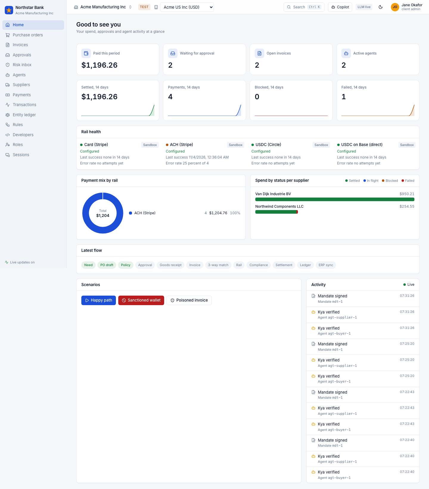

## 3. Card and ACH payments (Stripe test)

1. Sign in as Jane. On **Purchase orders**, ask the agent for something small, for example `Need 2 sample kits for the line 3 trial`.
2. Post the goods receipt, submit the supplier invoice and match it. Then open **Payments** and press Pay.
3. The router picks a rail. For a supplier that takes card it uses Stripe card (`pm_card_visa`). For ACH it uses Stripe test bank numbers. ACH takes a few minutes to settle.
4. Open the payment. The timeline shows created, routed, submitted, pending and settled. The Stripe event ids appear under Payloads.

## 4. Circle USDC and onchain USDC

These rails need test funds first. Get test USDC (and a little Base Sepolia ETH for gas) from [faucet.circle.com](https://faucet.circle.com). The faucet has a CAPTCHA, so you do this by hand.

- **Circle USDC**: fund the Circle sandbox wallet the BFF creates on first start.
- **Onchain USDC**: fund the Base Sepolia address the BFF prints when it starts.

Until a wallet is funded the router skips that rail. Keep onchain orders under 10 USD. When paid, the payment page links to Basescan.

## 5. A EUR payment with FX

1. In the top bar entity switcher pick **Acme Europe BV (EUR)** and pay a EUR invoice the same way.
2. When the payment is approved the rate is locked for 15 minutes. The payment settles in USD at the locked rate.
3. Open the payment and read the **FX quote and lock** card. The **Realised FX** box shows a gain or a loss. A gain is booked to account 7100 and a loss to 7200 in the **Entity ledger**.

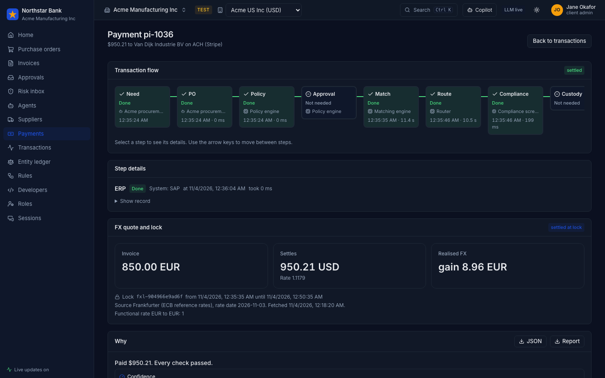

## 6. An approval with step-up

Orders above 10,000 USD need a person and a fresh authenticator code.

1. Sign in as Sam Rivera and open **Approvals**. Two orders of $12,600 (po-1041 and po-1042) wait there.
2. Each card shows the policy result, risk flags and the rule. The **Confirm it is you** box asks for a code. Press **Set up authenticator** the first time and scan it with an authenticator app.
3. Enter the 6 digit code, add a reason and press **Approve**. Without the code the Approve button stays off.

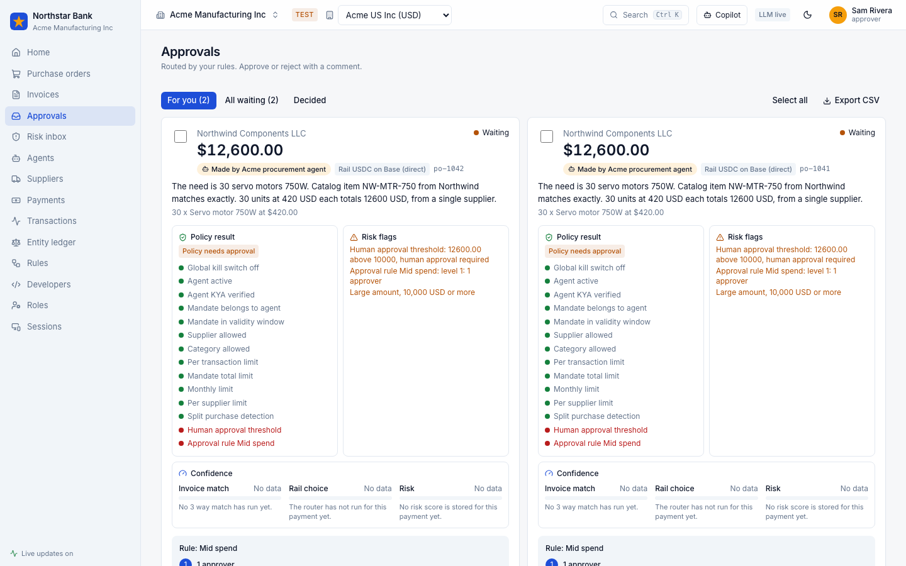
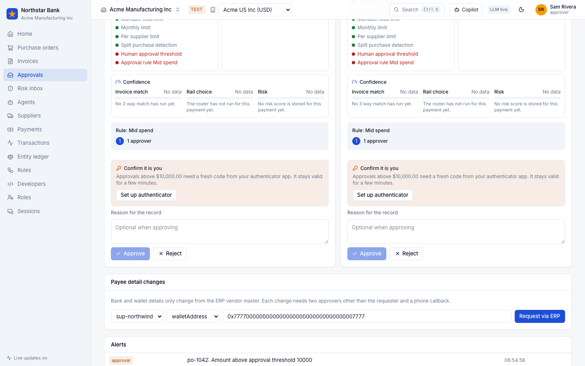

## 7. A blocked sanctions payment

On the client **Home**, press **Sanctioned wallet** in Scenarios. The supplier wallet is on the watchlist, so the payment stops before it reaches a rail and a case opens. Olivia can see the case in the operator **Compliance** page.

## 8. Why panel and export

Every payment page has a **Why** panel that explains each decision: policy, match, route, FX and compliance. Press **JSON** for the machine readable record or **Report** for a readable Markdown report.

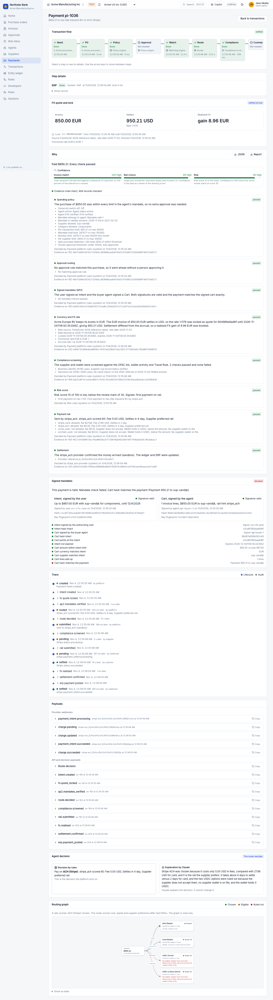

## 9. Risk inbox

Open **Risk inbox** in the client workspace or the operator console. It lists payments with a risk score and the reasons behind it, so you can check them first.

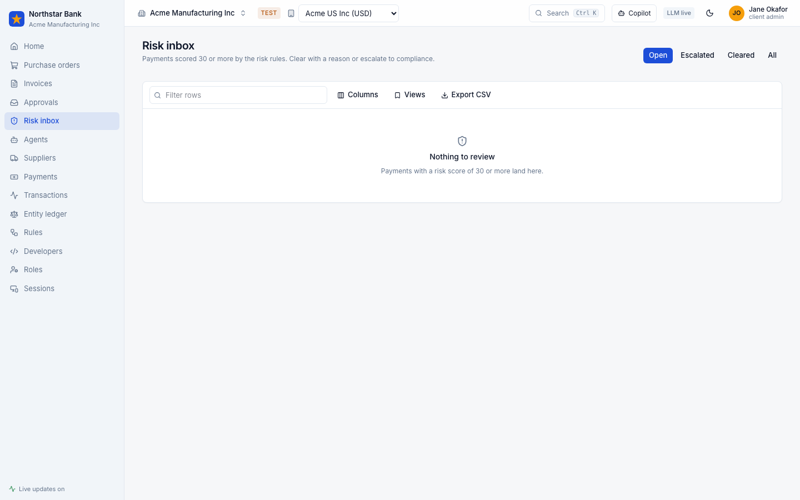

## 10. Copilot

Press **Copilot** in the top bar, or press <kbd>Ctrl</kbd> <kbd>K</kbd>, type a question and pick **Ask copilot**.

- **Questions**: try the suggested ones, such as `What is waiting for approval?`. Answers come from read-only tools on your own tenant and list their sources.
- **Proposals**: ask `approve po-1041 because goods received`. The copilot shows a **Proposed action** card. Nothing happens until you press **Confirm and run**, and then the normal API checks still apply. For po-1041 the API refuses with `step_up_required` until you give an authenticator code.
- **Snap to draft**: press the camera button and upload a PNG, JPEG, WEBP or PDF of an invoice. It becomes a draft invoice for review, never a payment.

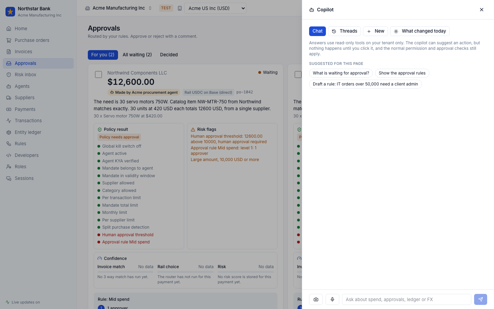
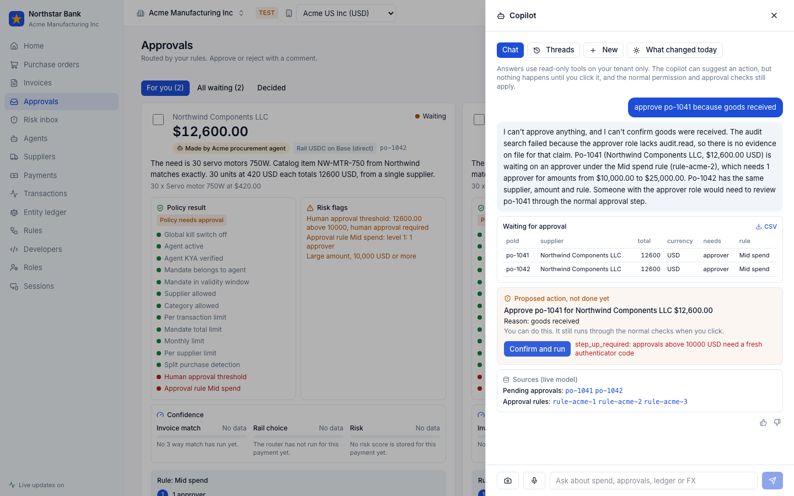
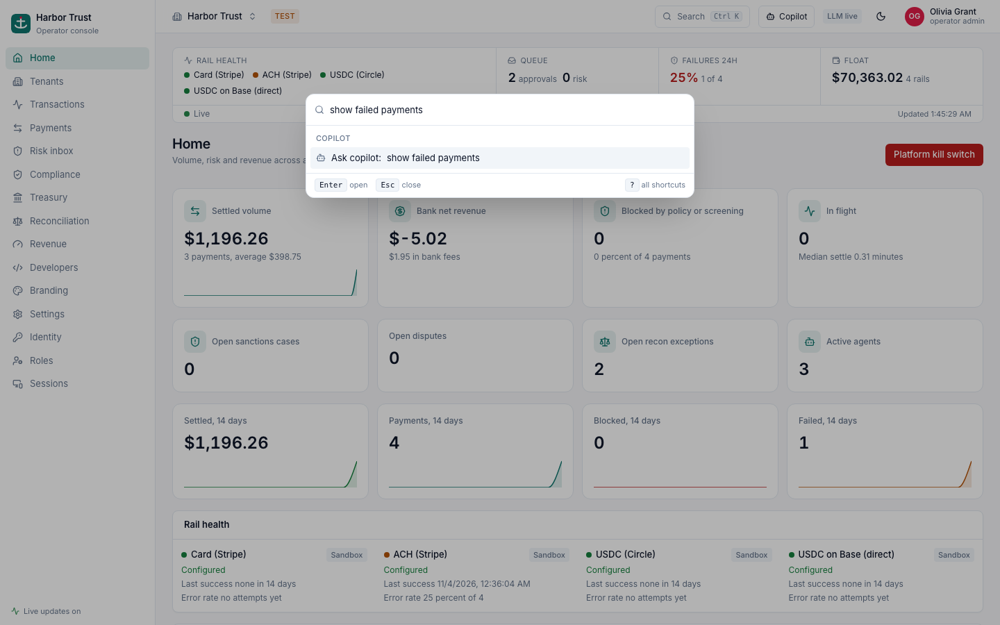

## 11. Connect an outside agent over MCP

1. On **Developers**, create an MCP server token. Pick the tools it may use and an expiry. The token shows once.
2. Connect a client, for example Claude Code:

   ```bash
   claude mcp add --transport http b2bpay http://127.0.0.1:8790/mcp --header "Authorization: Bearer mcp_test_..."
   ```

The MCP server only offers read-only tools, and every call is written to the evidence chain.

## 12. Supplier portal

On **Suppliers**, make a portal link for a supplier and open it in a private window. The supplier sees its own invoices and payments and can ask questions.

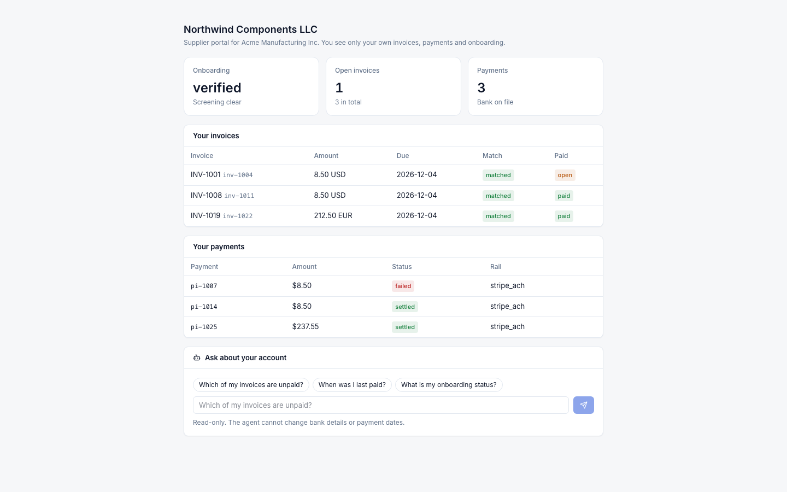

## 13. Switching a rail to live

Do this yourself, only when you mean to move real money.

1. Put the live keys in `.env` (`STRIPE_LIVE_SECRET_KEY`, `CIRCLE_LIVE_API_KEY`, `CIRCLE_LIVE_ENTITY_SECRET` or `ONCHAIN_LIVE_PRIVATE_KEY`) and restart.
2. As an operator admin open **Settings** and ask to switch the rail to Live.
3. A second operator admin must approve the change (maker checker). Without live keys the switch is refused. The top bar badge then shows **LIVE** in red.

## Mobile and dark mode

The app works at phone width (375 px) and in dark mode. Use the moon button in the top bar.

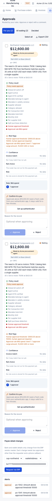
