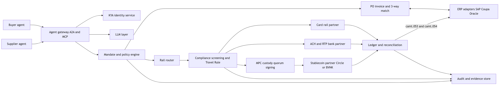
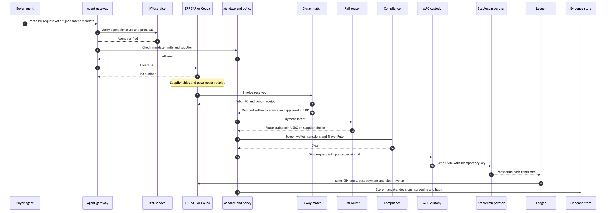

# 02 Design: B2B agentic commerce, agentic payments and stablecoin rail platform

As of 2026-11-03. Prepared by Ciklum presales. Inputs are the research files in `research/` (ranked-15d, L1-leaders, L2-startups, R1 to R4). No new web research was done. Facts from research carry the tag used in the source: (V) verified, (U) unverified. Anything not tagged is a design choice or an assumption. Check every (U) item before client use.

## 0. Problem in plain words

Companies want software agents to buy from suppliers and pay invoices, over cards, bank transfer and stablecoins, without losing control. The public agent payment protocols (AP2, ACP, x402, MPP, UCP) handle checkout and pay per request. They do not carry contract price, purchase order, approval chain or net terms (R1). That B2B layer, plus a safe policy gate and a rail router, is the gap this platform fills.

Key forces from research:

- The first live B2B agent pilot (Visa with BILL and Billtrust, 2026-10-20) pays only invoices a human has already approved (R4 High, V, confirmed by FinanceFeeds 2026-10-28).
- SAP Agent Gateway inbound A2A is GA (2026-10-27, V). Coupa Navi Connect exposes an MCP server with 30 plus tools (V). ERPs are now callable by outside agents.
- Mastercard Agent Pay for Machines settles over x402 with Coinbase, Base and BVNK, in fiat or stablecoin. Status is early access and pilot (APIs, toolkit, sandbox) as of 2026-10-20, not live. First announced June 2026 (V).
- OCC GENIUS Act final rule takes effect 2027-01-18. BSA, AML and OFAC rules are still to come (V, High).
- Stablecoin sends are final, so screening and Travel Rule must run before the send (R3).

## 0a. Corrections after verification (2026-11-03)

Source: verify/V1-research.md, V2-companies.md, V3-design.md.

| Claim | Corrected |
|---|---|
| Mastercard Agent Pay for Machines live 2026-10-20 | Early access and pilot. APIs, toolkit and sandbox only |
| Visa 17 percent business share dated 2026-11-01 | Published 2026-10-01 (FY2026 to date). 160 programs and about 200 percent growth published 2026-09-08 |
| OpenAI agent drained wallet funds in Oct 2026 | Sepolia testnet ETH. Incident 2026-06-26, report 2026-10-15 |
| Circle CPN Managed Payments launched 2026-10-19 | Launched Apr 2026 for banks and PSPs. Agent pitch in an Oct 2026 blog |
| ChatGPT Instant Checkout live | Wound down Mar 2026. Purchases finish on merchant sites. ACP continues |
| SAP Pay | GA for SAP Cloud ERP in US and UK, 2026-10-06, powered by Tereina, fiat plus USDC or EURC |
| Tempo | Mainnet 2026-03-18 with MPP. No token |
| Ramp more than 40k customers | More than 85k companies. Valued at about 60B USD (Oct 2026) |
| HSBC RedCoin 50,000 users in a week | Phased rollout from 2026-10-23 to about 3.3M eligible users. No activation count |
| PhotonPay Series C week of 2026-11-03 | 2026-10-29 |

### Companies added to the landscape

| Company | Why it matters |
|---|---|
| Tereina | SAP payments arm behind SAP Pay. Stablecoin capable inside the ERP |
| Cloudflare | Co author of Visa TAP and x402 Foundation work. Agent identity at the edge |
| Shopify | Merchant side of ACP and UCP. Tempo design partner |
| Nium | B2B cross border payouts with stablecoin moves |
| Airwallex | B2B cross border accounts and FX, stablecoin moves |
| Global Payments (Worldpay) | Large acquirer. Arc validator and stablecoin settlement moves |
| Klarna | Reported stablecoin on Tempo |

## 1. Capability map

Features found across leaders (L1 matrix) and startups (L2 matrix), grouped into platform modules.

| Module | Features in the market | Who has it (from matrices) | Call | Partner to use |
|---|---|---|---|---|
| M1 Agent gateway | A2A, MCP servers, protocol adapters for AP2, ACP, UCP, x402, MPP | Adyen one integration for UCP, ACP, AP2 (V). Coupa MCP (V). SAP A2A (V) | Build | Use open specs. No vendor needed |
| M2 Agent identity (KYA) | Agent registry, signed requests, agent passport | Visa TAP (V), Mastercard Agent Pay registry (V), Skyfire KYA (V), Kite Agent Passport (V), Catena ACK-ID (U) | Partner, with a thin own registry | Visa TAP and Mastercard Agent Pay for checks. Skyfire as KYA provider |
| M3 Mandate and policy engine | Intent, cart and payment mandates, spend limits, segregation of duties | AP2 mandates (spec public), Nekuda mandates (U), Ramp and Brex policy (U), Amex Intent Intelligence (V, part of ACE kit Apr 2026) | Build | Use AP2 mandate format |
| M4 B2B procure to pay | PO, contract price, invoice, 3-way match, approval | Coupa (V), SAP Ariba, Oracle, ORO Labs (V), Zip, Lio, Didero (U) | Build the match logic. Buy approvals from ERP | ERP stays system of record |
| M5 Tokenised credentials | Agent bound network tokens, virtual cards, shared payment token | Visa, Mastercard, Stripe SPT (V), Lithic (V), Basis Theory (V), Rain (V) | Buy | Stripe or Lithic for virtual cards. Basis Theory vault |
| M6 Rail router | Card, ACH, RTP, wire, stablecoin with fallback | Stripe, Bridge, BVNK (V for stablecoin), Zero Hash (V), Skyfire (V) | Build the router. Buy the rails | Stripe (card, ACH), bank partner for RTP, Bridge or BVNK for stablecoin |
| M7 Stablecoin issue, custody, ramps | USDC, PYUSD, JPMD, wallets, on and off ramp | Circle (CPN Managed Payments launched Apr 2026 for banks and PSPs, V. Agent use pitched in blog dated 2026-10-19, V), Paxos (issuer role U, no 2026 raise), Coinbase x402 (V), Kinexys JPMD on Base (V), Privy (U) | Partner | Circle (USDC, CPN), Coinbase x402 facilitator, at least two ramps per corridor (R3) |
| M8 Compliance | Wallet screening, sanctions, Travel Rule, KYB | Not in either matrix as a core feature. R3 says it must sit before any onchain send | Partner, own orchestration | Chainalysis or TRM style screening, a Travel Rule network provider (vendor to confirm) |
| M9 Ledger and reconciliation | Double entry, multi currency, onchain to ERP match | BILL, Billtrust ERP sync (U) | Build | Optional ledger product later |
| M10 ERP adapters | SAP, Coupa, Oracle connectors | SAP Agent Gateway (V), SAP Pay GA in US and UK 2026-10-06 via Tereina with USDC or EURC (V), Coupa Navi Connect MCP (V), Oracle Fusion AI Agent Studio (no agent payment launch found, U) | Build adapters on vendor APIs | SAP, Coupa, Oracle as partners |
| M11 Disputes and evidence | Dispute cover, evidence of mandate | Amex Agent Purchase Protection (V, 2026-04-14), Visa, Mastercard GA. No agent reason code yet (R4) | Build evidence store. Partner for cover | Card networks and Amex |
| M12 LLM layer | Buyer agent, supplier agent, invoice reading, exception triage | All leaders have agent kits | Buy model. Build prompts and tools | Claude or another model via a model gateway |

Main gaps no one covers well: B2B mandates tied to PO and contract terms, compliance before send, and one evidence trail across rails.

## 2. Persona debate

| Persona | Top needs | Red lines | Verdict on options |
|---|---|---|---|
| CTO | Ship in months, open protocols, avoid lock in, small team | No own chain, no own issuer | Picks B. A is fast but thin. C is years of work |
| CFO and treasury | Cash visibility, lower FX and wire fees, faster supplier pay, clean books | No unhedged coin balances overnight. No payment outside approved invoices | Picks B with same day conversion to fiat and approved coin list (R4) |
| Compliance and AML | Screening and Travel Rule before send, KYB on every supplier, full audit trail | No onchain send without screening. No issuer role without licence | Rejects C. Accepts B if compliance is a hard gate. A is fine but evidence sits with partners |
| Procurement lead | Agents follow contracts, catalogue and approval chains, PO match | Agent must not create new suppliers or change bank details | Picks B or A. Wants approvals left in SAP or Coupa |
| Security architect | Agent identity, scoped keys, policy outside the model, kill switch | Model must never hold keys or reach money directly (R4) | Picks B because the policy engine and keys stay in our control |
| Supplier | Paid on time, choice of rail, simple onboarding, remittance data | No forced crypto wallet. No extra fees | Neutral between A and B. Needs fiat option always |
| Agent platform engineer | Clear A2A and MCP tools, sandbox, idempotent APIs, test rails | No closed protocol only. No hidden rate limits | Picks B. Gateway with adapters absorbs protocol churn (R2) |

Debate outcome: six of seven pick B. The supplier is neutral. The CFO and compliance conditions become hard rules in the design (fiat fallback, approved coin list, screening gate).

## 3. Architecture options

- **A. Orchestration layer over partners.** Thin workflow app. Partners do identity, policy, rails and ledger. We hold UI and glue.
- **B. Own agent gateway, policy engine and rail router, partner rails.** We own the control plane (identity binding, mandates, match, routing, compliance orchestration, ledger, evidence). Partners move money and issue coins.
- **C. Full stack.** Option B plus own ledger of record, own stablecoin issuer or custody, own chain nodes.

Scores are 1 (poor) to 5 (strong). Weighted score equals the sum of weight times score, divided by 5, giving a result out of 100.

| Criterion | Weight | A score | A weighted | B score | B weighted | C score | C weighted |
|---|---|---|---|---|---|---|---|
| Time to market | 20 | 5 | 100 | 4 | 80 | 1 | 20 |
| Regulatory burden (low is good) | 20 | 5 | 100 | 4 | 80 | 1 | 20 |
| Differentiation | 15 | 2 | 30 | 5 | 75 | 4 | 60 |
| Cost to build and run | 15 | 4 | 60 | 3 | 45 | 1 | 15 |
| Rail flexibility | 10 | 3 | 30 | 5 | 50 | 4 | 40 |
| Control and auditability | 10 | 2 | 20 | 4 | 40 | 5 | 50 |
| Low partner lock in | 10 | 2 | 20 | 4 | 40 | 5 | 50 |
| **Total (sum)** | 100 | | 360 | | 410 | | 255 |
| **Score out of 100 (sum / 5)** | | | **72** | | **82** | | **51** |

Arithmetic check. A is 100 + 100 + 30 + 60 + 30 + 20 + 20 = 360, then 360 / 5 = 72. B is 80 + 80 + 75 + 45 + 50 + 40 + 40 = 410, then 410 / 5 = 82. C is 20 + 20 + 60 + 15 + 40 + 50 + 50 = 255, then 255 / 5 = 51.

Why C loses: issuing a payment stablecoin means a GENIUS licence with reserves and capital (OCC rule, V), and MiCA EMT rules in the EU (V). That is a bank sized project.

Sensitivity: if time to market weight rises to 35 and differentiation falls to 0, A scores 81 and B scores 79, so A edges ahead. At 30 and 5, B still leads 80 to 79. B wins in every case where the client values its own product, not a reseller wrapper.

## 4. Recommended target architecture (Option B)

### Components

| Component | Job | Build or partner |
|---|---|---|
| Agent gateway | Single entry for buyer and supplier agents. A2A and MCP servers. Protocol adapters for AP2, ACP, x402, MPP | Build |
| KYA identity service | Registers agents, binds each to a legal entity, ERP role and scoped key. Verifies Visa TAP signatures and Mastercard agent registration | Build registry, partner for checks |
| Mandate and policy engine | Stores signed mandates (AP2 format). Deterministic rules on amount, payee, category, rail, time. Segregation of duties. Kill switch. Runs outside the model (R4) | Build |
| PO, invoice and 3-way match | Matches PO, goods receipt and invoice within tolerance. Pulls approvals from ERP | Build |
| Rail router | Picks card, ACH, RTP, wire or stablecoin by cost, speed, supplier preference and policy. Falls back to fiat | Build router, partner rails |
| Compliance service | KYB, OFAC sanctions, KYT wallet screening, Travel Rule record on every transfer, self hosted wallet ownership proof, all before any onchain send | Orchestrate, partner engines |
| Custody service | MPC custody partner signs onchain sends. Second policy gate with approver quorum above a threshold. Freeze on kill switch | Partner |
| Refund service | Refunds as new linked payments. Release delay for first time or changed payees | Build |
| Ledger and reconciliation | Double entry ledger of record for the platform. Matches rail confirmations and onchain hashes to invoices | Build |
| ERP adapters | SAP (Agent Gateway A2A), Coupa (Navi Connect MCP), Oracle Fusion (REST) | Build |
| Audit and evidence store | Append only store of mandate, policy decision, screening result, rail receipt, hash. Feeds disputes | Build |
| LLM layer | Agents propose intents, read invoices and triage exceptions. Never holds keys or approves money | Partner model, build tools |

### Component flowchart

Source: [diagrams/02-1.mmd](diagrams/02-1.mmd), vector: [SVG](diagrams/02-1.svg)

### Sequence: PO to stablecoin settlement

Source: [diagrams/02-2.mmd](diagrams/02-2.mmd), vector: [SVG](diagrams/02-2.svg)

### Non functional targets (assumptions)

- Policy decision under 200 ms. Payment initiation 99.9 percent available.
- Every money call idempotent, with retries on a queue and a dead letter path.
- Event bus between modules so rails can be added without touching policy.
- Revisit as the system grows: ledger product versus own, multi region data residency, a second stablecoin partner, the coming BSA and AML rule under GENIUS.

## 5. Decision framework

| Decision | Options | Factors to weigh | Recommendation and why |
|---|---|---|---|
| Where approvals live | Platform or ERP | Audit, user habit, pilot evidence | ERP first. The Visa pilot pays only approved invoices (R4) |
| Mandate format | AP2, own, ACP | Openness, rail neutral, B2B fit | AP2 with B2B fields (PO, contract, terms). AP2 is rail neutral (R2) |
| Agent identity | Own only, network only, both | Merchant acceptance, cost, churn | Own registry plus Visa TAP and Mastercard checks. KYA is first class (R2) |
| Stablecoin role | Issue, custody, use partner | GENIUS licence, MiCA, capital | Use partner. Issuing needs a licence under the OCC rule (V) |
| Which coin and chain | USDC, PYUSD, JPMD, chains | Liquidity, regulation, supplier demand | USDC first, approved list by region (R4). Watch Arc (mainnet 2026-09-16, V) and Tempo (mainnet 2026-03-18 with MPP, V) |
| Ramps | One or many | Fee and risk sit at ramps (R3) | Two per corridor, wire fallback |
| Rail choice per payment | Fixed or routed | Cost, speed, finality, disputes | Routed by policy. Card for disputes, stablecoin for cross border speed |
| Compliance timing | Before or after send | Finality of onchain sends | Before send, as a hard gate (R3) |
| Ledger | Build, buy | Control, time, audit | Build a simple double entry ledger now. Review a ledger product at scale |
| Model access to money | Direct tools, mediated | Prompt injection, overreach (R4 item 8) | Mediated only. Model proposes, policy decides |
| Protocol support | Pick one, adapters | Churn across ACP, UCP, AP2, x402, MPP (R2) | Adapter per protocol behind the gateway |

## 6. Data model and API surface

### Core entities

| Entity | Key fields |
|---|---|
| Organisation | id, legal_name, type (buyer or supplier), kyb_status, country |
| Agent | id, org_id, name, public_key, kya_status, erp_role, protocols, status (active or suspended) |
| Mandate | id, agent_id, principal_user_id, type (intent, cart, payment), max_amount, currency, allowed_suppliers, allowed_rails, valid_from, valid_to, signature |
| PolicyRule | id, org_id, rule_type, params, priority |
| Supplier | id, org_id, bank_details_ref, wallet_address, preferred_rail, screening_status |
| PurchaseOrder | id, buyer_org_id, supplier_id, erp_ref, lines, total, currency, status |
| GoodsReceipt | id, po_id, lines, received_at |
| Invoice | id, po_id, supplier_id, amount, currency, due_date, match_status, erp_approval |
| PaymentIntent | id, invoice_id, mandate_id, amount, currency, status, idempotency_key |
| Route | id, payment_intent_id, rail (card, ach, rtp, wire, stablecoin), coin, chain, fee_estimate, reason |
| ComplianceCheck | id, payment_intent_id, kind (sanctions, wallet, travel_rule, kyb), result, provider_ref |
| LedgerEntry | id, journal_id, account, debit, credit, currency, ref |
| Settlement | id, payment_intent_id, rail_ref, tx_hash, confirmed_at, status |
| RefundIntent | id, original_payment_intent_id, amount, reason, status, settlement_id |
| EvidenceRecord | id, subject_type, subject_id, payload_hash, created_at, prev_hash |

### API surface sketch (REST, JSON, plus MCP tools with the same names)

| Method and path | Purpose |
|---|---|
| POST /agents | Register agent with public key |
| POST /agents/{id}/verify | Run KYA checks |
| POST /mandates | Store signed mandate |
| POST /policy/evaluate | Dry run a payment intent against rules |
| POST /purchase-orders | Create PO (pushes to ERP adapter) |
| POST /goods-receipts | Record receipt |
| POST /invoices | Submit invoice (supplier agent) |
| POST /invoices/{id}/match | Run 3-way match |
| POST /payment-intents | Create intent from matched invoice |
| POST /payment-intents/{id}/route | Get rail decision |
| POST /payment-intents/{id}/execute | Screen then send, needs Idempotency-Key header |
| GET /settlements/{id} | Status and hash |
| GET /ledger/journals | Ledger view |
| GET /evidence/{subject_id} | Full evidence chain |
| POST /agents/{id}/suspend | Kill switch. Cancels queued intents, revokes mandates, freezes custody |
| POST /refunds | Create linked refund payment |
| GET /statements/camt053 | Daily statement per wallet for ERP import |
| POST /webhooks/rails | Rail and chain callbacks |

## 7. MVP scope for the demo app

No real funds. Stablecoin moves on a simulated ledger.

| Module | MVP status | Notes |
|---|---|---|
| Agent gateway with MCP server and one A2A endpoint | Real | Real protocol shape, local only |
| KYA identity | Real, simplified | Own registry with key signatures. Visa TAP and Mastercard checks simulated |
| Mandate and policy engine | Real | Core of the demo. Deterministic rules, kill switch |
| PO, invoice and 3-way match | Real | Seed data, tolerance rules |
| LLM layer | Real | Buyer agent and invoice reading on a live model. Run live specs once at the end |
| Rail router | Real logic, simulated rails | Card, ACH, RTP and stablecoin adapters return mock receipts |
| Stablecoin settlement | Simulated | Simulated USDC ledger with fake tx hashes and confirmation delay |
| Compliance screening and Travel Rule | Simulated | Mock provider with a sanctioned wallet case to show a block |
| Ledger and reconciliation | Real | Double entry in the app database |
| ERP adapters | Simulated | Mock SAP and Coupa endpoints that mirror real payload shapes |
| Audit and evidence store | Real | Hash chained records, evidence view per payment |
| Disputes | Out of scope | Show evidence export only |

Demo story: buyer agent raises a PO under a mandate, supplier agent sends an invoice, match passes, router picks USDC, a screening block is shown on a bad wallet, the good path settles on the simulated ledger and posts back to the mock ERP, and the evidence view shows every step.

## 8. Changes after red team

Source: 03-redteam-gaps.md (12 gaps, 3 critical).

| Gap | Change |
|---|---|
| G1 no reversal | RefundIntent entity, POST /refunds, release delay for new or changed payees, card rail where dispute cover is needed |
| G2 prompt injection | Supplier bank and wallet changes only in ERP master data with four eyes and callback. LLM output is untrusted data. Invoice values checked against PO. Split invoice and near threshold alerts. Injection tests in CI |
| G3 custody | MPC custody partner as second gate, quorum signing above threshold, decision id must match |
| G4 Travel Rule and AML | Travel Rule provider and KYT, OFAC as own step, Travel Rule record on every transfer, wallet ownership proof at onboarding |
| G5 reconciliation | camt.053 daily and camt.054 per payment, tx hash in end to end id |
| G6 liability | Platform terms with mandate based liability split |
| G7 SOX | Separate agent owner, mandate signer and policy admin roles. Two approver rule changes |
| G8 net terms | Pay on due date schedule, early pay discount, credit partner hook |
| G9 depeg | End of day sweep to fiat, depeg alarm pauses stablecoin rail |
| G10 lock in | Adapter interfaces for custody, ramps, screening |
| G11 chain reliability | Confirmation depth, nonce manager, chain health into router, outbox for money events |
| G12 kill switch | Cancels queued intents and freezes custody |

MVP adds: simulated custody quorum, a refund demo, a poisoned invoice that tries to change the wallet and is blocked, and a camt.053 export.
