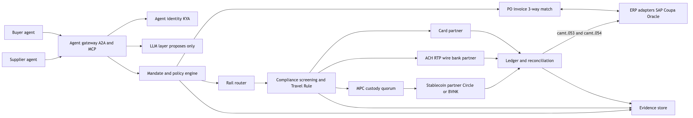

# B2B Agentic Payments and Stablecoin Rails: Final Recommendation

As of 2026-11-03. Prepared by Ciklum presales. Built from research/, 02-design.md, 03-redteam-gaps.md and the verify/ checks. Tags: (V) verified, (U) unverified. Check every (U) item before client use. All open items were checked in V4.

## 1. Executive summary

- Software agents can now reach ERPs and pay suppliers. SAP Agent Gateway A2A is GA (2026-10-27) and Visa runs a live B2B pilot with BILL and Billtrust (2026-10-20). Both pay only invoices a human has approved.
- Public agent protocols (AP2, ACP, x402, MPP, UCP) handle checkout. None carry purchase order, contract price, approval chain or net terms. That B2B control layer is the open gap.
- We recommend Option B: own the agent gateway, policy engine and rail router, and partner for rails, custody and coins. It scores 82 of 100 against 72 for a thin wrapper and 51 for full stack.
- Stablecoin is one routed rail, not the product. Card, ACH, RTP and wire stay first class, and every stablecoin send passes screening and Travel Rule before it leaves.
- A 90 day MVP on simulated money proves the story. Real money pilots follow in months 3 to 9 once the OCC GENIUS rule takes effect (2027-01-18).

## 2. Ranked signals from the last 15 days

| Rank | Date | Signal | Status | Why it matters |
|---|---|---|---|---|
| 1 | 2026-10-27 | SAP Agent Gateway inbound A2A GA | V | Outside agents can call SAP with user rights |
| 2 | 2026-10-21 | OCC GENIUS Act final rule, effective 2027-01-18 | V | Sets the legal base for US payment stablecoins. AML rule still to come |
| 3 | 2026-10-20 | Visa pilot with BILL and Billtrust over TAP | V | First live B2B agent payments, approved invoices only |
| 4 | 2026-10-19 | Mastercard Stablecoin Security, screening before funds move | V | Screening before send is becoming the norm |
| 5 | 2026-10-20 | Mastercard Agent Pay for Machines on x402 with BVNK | V, early access and pilot, not live | Card network now routes stablecoin for agents |
| 6 | Oct 2026, GA planned Nov 2026 | ORO Labs resold as SAP Ariba Procurement Orchestration | V | Procurement orchestration enters the ERP suite |
| 7 | 2026-10-29 | PhotonPay 40M USD Series C | V | Money still flows to stablecoin B2B rails |
| 8 | 2026-10-23 | HSBC RedCoin phased rollout to about 3.3M eligible PayMe users | V (no activation count) | Banks ship retail coins in Hong Kong |
How signals are ranked: each item scores 1 to 5 on recency, source authority and B2B relevance, and the sum sets the rank (full scores in research/ranked-15d.md). Only items dated 2026-10-19 to 2026-11-03 are ranked.

Older context often quoted as new: report on an OpenAI agent spending wallet funds on testnet (2026-10-15), Mastercard KYA with Skyfire (2026-09-30), Visa 17 percent business share (published 2026-10-01), Circle CPN Managed Payments (launched Apr 2026), SAP Pay GA in US and UK via Tereina (2026-10-06), Tempo mainnet (2026-03-18), ChatGPT Instant Checkout wound down (Mar 2026).

## 3. Leaders and startups capability matrix

Check status: cells come from V2 company checks. Cells marked P or tagged reported are (U) until a primary source is found.

Y means has it today. P means pilot or early access. Blank means not found.

| Company | Agent identity | Mandates and policy | B2B procure to pay | Tokenised credentials | Stablecoin rail | Compliance before send |
|---|---|---|---|---|---|---|
| Visa | Y (TAP) | Y | P (BILL pilot) | Y | Y (settlement) | |
| Mastercard | Y (Agent Pay, KYA) | Y | | Y | P (Machines, BVNK) | Y (Stablecoin Security) |
| Stripe and Bridge | Y (SPT) | P | | Y | Y | |
| Circle | | | | | Y (CPN, Arc) | |
| Coinbase | | | | | Y (x402) | |
| SAP and Tereina | Y (Agent Gateway) | | Y | | Y (SAP Pay, USDC or EURC) | |
| Coupa | Y (Navi Connect MCP) | | Y | | | |
| Ramp (85k+ customers) | | Y | P | Y | | |
| BVNK | | | | | Y | |
| Skyfire | Y (KYA) | P | | | Y | |
| ORO Labs | | Y | Y | | | |
| Rain, Lithic, Basis Theory | | | | Y | Y (Rain) | |
| Cloudflare | Y (TAP, x402 work) | | | | | |
| Shopify | | | | | P (Tempo partner) | |
| Nium, Airwallex | | | | Y | P | |
| Global Payments (Worldpay) | | | | Y | P (Arc validator) | |
| Klarna | | | | | P (reported, Tempo) | |

Nobody covers B2B mandates tied to PO and contract terms, compliance before send across all rails, and one evidence trail across rails. Those three are the design focus.

## 4. How they build it

Check status: patterns drawn from V verified items in section 2 and V2. No new facts here.

- **Identity.** Signed HTTP requests (Visa TAP with Cloudflare) or a registry of agents (Mastercard, Skyfire). The agent key is bound to a person or company.
- **Credentials.** Network tokens or shared payment tokens, so the agent never sees a card number.
- **Mandates.** Signed intent and cart records (AP2). Policy runs outside the model.
- **Stablecoin.** Partners issue (Circle, Paxos) and move coins (Bridge, BVNK, Coinbase x402). Card networks wrap them so merchants see a normal payment.
- **ERP.** SAP and Coupa expose A2A and MCP endpoints. Approvals stay in the ERP.

## 5. Multi persona outcome

| Persona | Pick | Main objection | How the design answers it |
|---|---|---|---|
| CTO | B | Owning a ledger is a heavy run cost | Ledger scope kept to payments of record, ERP stays the book of record |
| CFO and treasury | B | Coin balances add FX and depeg risk | End of day sweep to fiat, approved coin list, depeg pause |
| Compliance | B | Onchain sends are final, a miss cannot be undone | Screening, OFAC and Travel Rule as a hard gate before custody signs |
| Procurement | B or A | A new tool may bypass SAP or Coupa approvals | Approvals stay in the ERP. The platform only pays approved, matched invoices |
| Security | B | Prompt injection could steer payments | Keys and policy outside the model, payee changes only in ERP with four eyes |
| Supplier | Neutral | Being forced onto wallets | Fiat always available, stablecoin is optional |
| Agent platform engineer | B | Protocols churn every quarter | One adapter per protocol behind the gateway |

Six of seven pick B. Procurement accepted B once approvals were confirmed to stay in the ERP, so the open "B or A" is resolved in favour of B.

## 6. Options and scores

| Option | What it is | Score of 100 |
|---|---|---|
| A. Orchestration over partners | Thin workflow app. Partners do everything else | 72 |
| **B. Own gateway, policy and router, partner rails** | We own the control plane. Partners move money and issue coins | **82** |
| C. Full stack | B plus own issuer, custody and chain nodes | 51 |

Per criterion scores (1 poor to 5 strong, weighted score is weight times score divided by 5):

| Criterion | Weight | A | B | C |
|---|---|---|---|---|
| Time to market | 20 | 5 | 4 | 1 |
| Regulatory burden (low is good) | 20 | 5 | 4 | 1 |
| Differentiation | 15 | 2 | 5 | 4 |
| Cost to build and run | 15 | 4 | 3 | 1 |
| Rail flexibility | 10 | 3 | 5 | 4 |
| Control and auditability | 10 | 2 | 4 | 5 |
| Low partner lock in | 10 | 2 | 4 | 5 |
| Score of 100 | | 72 | 82 | 51 |

Weights: time to market 20, regulatory burden 20, differentiation 15, cost 15, rail flexibility 10, control 10, lock in 10. Sensitivity: with time to market at 35 and differentiation at 0, A scores 81 and B 79. B wins whenever the client wants its own product.

## 7. Target architecture

Source: [diagrams/04-1.mmd](diagrams/04-1.mmd), vector: [SVG](diagrams/04-1.svg)

Payment path in plain words: the buyer agent raises a PO under a signed mandate. The supplier invoices. The match passes and the ERP approves. The router picks a rail. Compliance clears the payee. Custody signs only if the policy decision id matches. The ledger posts back to the ERP as a bank statement.

## 8. Red team gaps and fixes

| ID | Gap | Severity | Fix |
|---|---|---|---|
| G1 | Stablecoin sends cannot be reversed | Critical | Linked refund payment, release delay for new payees, card rail where dispute cover is needed |
| G2 | Prompt injection in invoices | Critical | Bank and wallet changes only in ERP with four eyes and callback. LLM output is untrusted data |
| G3 | No custody model | Critical | MPC custody partner as second gate, quorum above threshold |
| G4 | Travel Rule and AML unclear | High | Travel Rule record on every transfer, KYT, OFAC as its own step, wallet ownership proof |
| G5 | No ERP statement format | High | camt.053 daily and camt.054 per payment |
| G6 | Liability not assigned | High | Liability matrix below, written into platform terms and tied to mandate evidence |
| G7 | SOX duties not split | High | Separate agent owner, mandate signer and policy admin |
| G8 | Net terms missing | Medium | Pay on due date, early pay discount, credit hook |
| G9 | Coin balances and depeg | Medium | End of day sweep, depeg pause |
| G10 | Partner lock in | Medium | Adapters for custody, ramps and screening. Circle CPN primary, BVNK secondary |
| G11 | Chain reliability | Medium | Confirmation depth, nonce manager, chain health into router |
| G12 | Kill switch too narrow | Low | Cancels queued intents and freezes custody |

### Liability matrix (proposed, for platform terms)

| Failure | First loss | Why | Recovery path |
|---|---|---|---|
| Agent acts outside its mandate | Platform operator | Policy engine should have blocked it | Refund from operator, fix rule |
| Agent acts inside a bad mandate | Buyer company | The mandate signer approved the limits | Linked refund request to supplier |
| Injected invoice changes payee | Party that changed ERP master data without four eyes | The control sits in the ERP | Freeze, claim against supplier or insurer |
| Onchain send to a screened bad wallet | Platform operator and screening partner per contract | Screening is a hard gate | Partner indemnity, report to regulator |
| Chain or custody failure | Custody or stablecoin partner per contract | Partner runs that layer | Partner SLA and indemnity |
| Card rail dispute | Card network rules | Network rules apply as today | Chargeback with evidence export |

This is a proposal for legal review, not legal advice.

## 9. Decision framework

Check status: recommendations rest on V items in sections 2 and 6.

| Key decision | Factors | Recommendation | Why |
|---|---|---|---|
| Where approvals live | Audit, user habit | ERP | The live Visa pilot pays only approved invoices |
| Mandate format | Openness, B2B fit | AP2 plus PO, contract and terms fields | AP2 is rail neutral and public |
| Agent identity | Acceptance, churn | Own registry plus Visa TAP and Mastercard checks | Merchants check network identity, we need our own binding to ERP roles |
| Stablecoin role | Licence, capital | Use partners | Issuing needs a GENIUS licence |
| Coin and chain | Liquidity, demand | USDC first, approved list per region | Deepest liquidity, SAP Pay supports USDC and EURC |
| Stablecoin partners | Coverage, lock in | Circle CPN primary, BVNK secondary | CPN covers USDC and EURC payouts, BVNK backs Mastercard Agent Pay for Machines |
| Rail per payment | Cost, speed, disputes | Routed by policy | Card for dispute cover, stablecoin for cross border speed |
| Compliance timing | Finality | Before send | Onchain sends are final |
| Model access to money | Injection risk | Mediated only | The model proposes, policy decides |
| Protocols | Churn | Adapter per protocol | ACP, UCP, AP2, x402 and MPP keep moving. Instant Checkout already wound down |

## 10. MVP scope (90 days, no real funds)

| Real | Simulated |
|---|---|
| Agent gateway (MCP and one A2A endpoint) | Visa TAP and Mastercard checks |
| Mandate and policy engine, kill switch | Card, ACH, RTP rails with mock receipts |
| 3-way match on seed data | USDC ledger with fake hashes |
| LLM buyer agent and invoice reading via the claude CLI | Compliance provider with one sanctioned wallet |
| Double entry ledger, camt.053 export | SAP and Coupa endpoints |
| Hash chained evidence view | Custody quorum |

Demo story: PO under mandate, invoice, match, router picks USDC, a bad wallet is blocked, a poisoned invoice that tries to change the wallet is blocked, the good path settles and posts to the mock ERP, a refund runs, and the evidence view shows every step.

### Working build

Repo: ~/git/agentic-b2b-pay (npm workspaces).

| Part | What it does |
|---|---|
| shared | zod schemas for PO, invoice, mandate, payment and evidence |
| bff | Fastify server on BFF_PORT (default 8790). Policy, match, router, compliance gate, ledger, evidence chain |
| web | React and Vite console on 5180 with buyer, approver, supplier and treasury views |
| LLM adapter | Runs `claude -p --output-format json` for realtime agent reasoning, 60 second timeout, mock fallback via LLM_MODE=live or mock |

The model only proposes. Its JSON output is parsed as untrusted data and must pass the deterministic policy, match and compliance steps before any payment. Tests: 32 of 32 unit tests pass without a model, and one live e2e run with the claude CLI passed. Browser checks covered the USDC happy path, a blocked sanctioned wallet and a poisoned invoice sent to approval.

## 11. Risks

| Risk | Likelihood | Impact | Mitigation |
|---|---|---|---|
| GENIUS AML and BSA rule lands late or strict | Medium | High | Compliance as pluggable gate, fiat fallback |
| Protocol churn (product shutdowns like Instant Checkout) | High | Medium | Adapters behind the gateway |
| Partner early access slips (Mastercard Machines) | Medium | Medium | Two stablecoin partners per corridor |
| Agent fraud through injected invoices | Medium | High | ERP master data control, injection tests in CI |
| Supplier adoption of wallets is low | High | Low | Fiat always available, stablecoin is optional |
| Single source facts in the pitch | Medium | Medium | Use only V items in client material |
| EU and Hong Kong rules differ from GENIUS | Medium | Medium | MiCA treats EURC as an e-money token with issuer and CASP rules. Hong Kong licenses fiat backed stablecoin issuers under its 2025 Stablecoins Ordinance (U, check before use). Approved coin and partner list per region |

## 12. Roadmap

| Window | Goals |
|---|---|
| 0 to 3 months | MVP on simulated money. Gateway, policy, match, router, ledger, evidence. One SAP or Coupa sandbox. Partner shortlist for custody, screening and stablecoin |
| 3 to 9 months | Pilot with one client and real fiat rails. USDC on one corridor after OCC rule takes effect. MPC custody, Travel Rule provider, refund flow, camt feeds to SAP. SOX role split |
| 9 to 18 months | More corridors and coins (EURC, PYUSD). Second stablecoin and custody partner. Net terms and credit hook. Network agent identity in production. Dispute evidence export to card networks |

## 13. Verification summary

| Check | Checked | Verified | Wrong and fixed | Unverified |
|---|---|---|---|---|
| V1 research signals | 18 | 7 | 4 | 7 |
| V2 company claims | 18 | 13 (one date fix, one refined) | 1 | 4 |
| V3 design checks | 11 | 10 | 1 (sensitivity line) | 0 |
| Total first pass (V1 to V3) | 47 | 30 | 6 | 11 |
| V4 recheck of open items | 13 (the 11 open plus 2 items flagged in review) | 5 | 6 | 2 (unsupported) |

V4 is a recheck, not new checks, so it is not added to the total. After V4 the open items are the 2 unsupported claims below.

V5 independent recheck (verify/V5-independent.md and verify/V5-weak-sources.md, 2026-11-03) agreed with V4 on 11 of 13 items. It corrected the Visa date and downgraded Circle to weak. Stripe, SAP and FinCEN rest on secondary sources only.

V4 open claims check (verify/V4-open-claims.md, 2026-11-03):

- Oracle AI World 25 agentic apps on Fusion Claw, 2026-10-26 (V, primary oracle.com release found in search index, page blocks fetch. V5 rated it U because only the March release with 22 apps could be opened)
- Mastercard AP4M is Agent Pay for Machines, same early access item, still pilot (corrected)
- SAP Enterprise AI Gateway announced at TechEd, availability planned Q1 2027 (corrected)
- Coupa Navi Connect MCP announced, no public setup guide found (unsupported, absence not provable)
- Lightning Labs agent tools on live Lightning, released 2026-02-11, not in window (corrected)
- Visa Intelligent Commerce Connect, one integration, announced 2026-04-08 per Visa release, pilot (corrected again in V5)
- Revenium joining the Agentic AI Foundation (unsupported, removed. It joined the FinOps Foundation)
- Stripe Treasury for agents, 2026-10-21, via Stripe MCP (V, primary)
- Adyen Agentic, 2026-06-16, limited US enterprise availability (V, primary)
- Amex ACE kit and Agent Purchase Protection 2026-04-14, Intent Intelligence is part of the kit (corrected)
- Crossmint 23.6M USD (Mar 2025), Lithic 60M USD Series C (Jul 2021), Paxos Labs 12M USD (Apr 2026) (corrected)
- Circle CPN agent blog dated 2026-10-19 (still weak. circle.com refuses fetch and browser access, only translated copies seen in V5. Check in a normal browser before client use)
- FinCEN withdrew two crypto proposals, 2026-10-05 (V, fincen.gov)

## 14. Sources

- https://architecture.learning.sap.com (SAP Agent Gateway A2A)
- https://www.occ.gov/news-issuances/news-releases/2026/nr-occ-2026-92.html
- https://occ.gov/news-issuances/bulletins/2026/bulletin-2026-50.html
- https://www.skadden.com/insights/publications/2026/10/occ-finalizes-genius-act-rule
- https://financefeeds.com/agentic-payments-visa-pilot-mastercard-kya/
- https://investor.visa.com and https://bill.com (pilot releases)
- https://www.theblock.co and https://decrypt.co (Mastercard Agent Pay for Machines status)
- https://community.sap.com and https://www.cfodive.com (SAP Pay GA)
- https://www.ledgerinsights.com (Tempo mainnet)
- https://www.circle.com/blog (CPN Managed Payments)
- https://www.prnewswire.com (Ramp Oct 2026 release)
- https://www.americanbanker.com (PhotonPay)
- https://www.scmp.com (HSBC RedCoin)
- https://cointelegraph.com (OpenAI testnet case)
- https://www.spark.money/research/payment-reversal-stablecoin-chargeback-gap
- https://sofy.ai/blog/prompt-injection-testing-erp-agents/
- https://protofire.io/guides/crypto-custody/
- https://notabene.id/crypto-travel-rule-101/what-is-the-crypto-travel-rule
- https://help.sap.com/doc/d38a485b480f45849e0cf6ce8d80f65b/SHIP/en-US/732a7a3bd7c540b5a1b750f80ca29168.pdf
- https://www.finextra.com/blogposting/31251/deep-dive-the-hidden-liability-of-agentic-commerce
- https://stripe.com/newsroom/news/treasury-for-agents
- https://www.adyen.com/press-and-media/adyen-agentic
- https://www.fincen.gov/news/news-releases/fincen-announces-withdrawals-proposed-digital-asset-related-rules
- Full lists in research/ and verify/
